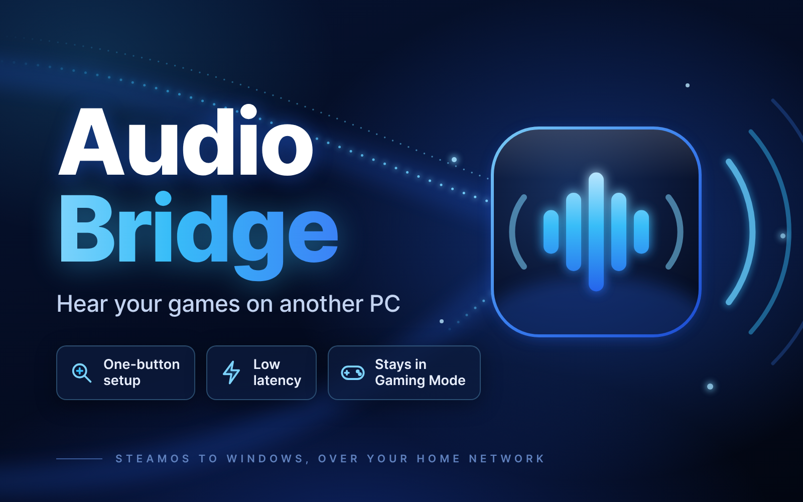
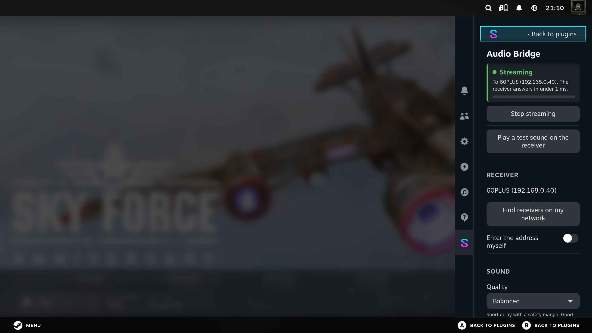
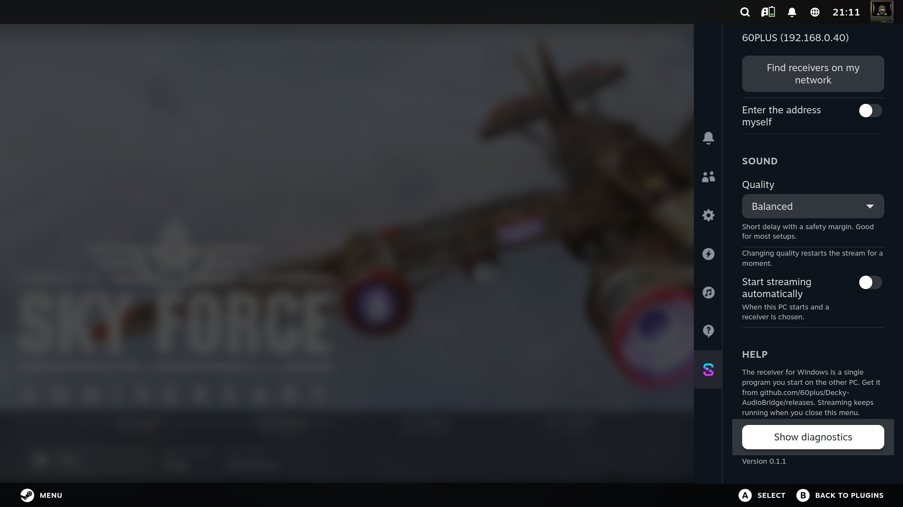
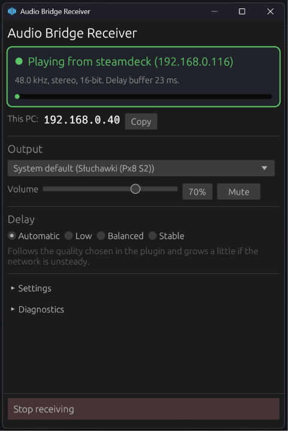

# Audio Bridge

[](https://github.com/60plus/Decky-AudioBridge/releases)
[](https://github.com/60plus/Decky-AudioBridge/releases/latest)
[](https://github.com/60plus/Decky-AudioBridge/stargazers)
[](LICENSE)
[](https://buymeacoffee.com/60plus)

### Hear your games on another PC.

Listen to your SteamOS gaming PC on another computer. Audio Bridge is a plugin
for **SPlug and Decky Loader** that sends the sound of your games over your home
network to a Windows PC, where a small receiver plays it on the headphones or
speakers you choose. You stay in Gaming Mode the whole time.



**[Latest release: plugin and Windows receiver](https://github.com/60plus/Decky-AudioBridge/releases/latest)**

- Start and stop streaming from the Quick Access menu.
- Find the receiver on your network with one button, no typing needed.
- Choose between low latency, balanced and high quality.
- Streaming keeps running when you close the menu or reload Decky.

## What you need

- A SteamOS PC or Steam Deck with Decky Loader or SPlug.
- A Windows 10 or 11 PC on the same local network.
- A wired connection on at least one side is best. Wi-Fi works, with a little
  more delay.

## Setup

1. **On the Windows PC**, download `AudioBridgeReceiver.exe` from the
   [Releases](https://github.com/60plus/Decky-AudioBridge/releases) page and
   start it. No installation is needed. When Windows asks whether to allow it
   through the firewall, click **Allow**.
2. **On SteamOS**, install Audio Bridge and open it from the Quick Access menu.
3. Press **Find receivers on my network** and pick your PC. If it does not show
   up, turn on **Enter the address myself** and type the address shown in the
   receiver window, for example `192.168.0.40`.
4. Press **Start streaming**. **Play a test sound on the receiver** confirms
   that everything works.

To have the receiver ready all the time, open **Settings** in the receiver and
tick **Start with Windows**. To stream every time the gaming PC starts, turn on
**Start streaming automatically** in the plugin.

## Screenshots

The panel while streaming, with a game running:



Quality, automatic start and help further down the panel:



The receiver on Windows:



## Quality presets

The presets trade delay against tolerance for network hiccups. Low latency
is the fastest, High quality is the most forgiving. On a cable all three
work, so choose by how much delay you accept. Wi-Fi delivers packets
unevenly, and a larger buffer rides that out.

| Preset | Sound | Receiver buffer | On a cable | On Wi-Fi |
| --- | --- | --- | --- | --- |
| Low latency | 16-bit, 48 kHz | about 20 ms | Best for fast games | May crackle |
| Balanced | 16-bit, 48 kHz | about 40 ms | Works well | Works on most networks |
| High quality | 24-bit, 48 kHz | about 80 ms | Works, with more delay than needed | Steadiest choice |

On a cable, start with Low latency. On Wi-Fi, start with Balanced and move to
High quality if you hear crackles.

The buffer is only part of the total delay. Capture, the network and the sound
card on the receiving PC add to it, so the delay you hear is longer than the
number above. The receiver's **Delay** setting can override the preset, and on
**Automatic** it adds a few milliseconds by itself when the network is
unsteady.

The stream carries uncompressed audio, about 1.6 Mbit/s for 16-bit stereo and
2.4 Mbit/s for 24-bit.

## Good to know

- The stream is taken from the monitor of the gaming PC's current output, so it
  carries everything you would hear: games, Steam sounds and notifications. The
  microphone is never included.
- Changing the volume on the gaming PC does not change the stream. Use the
  volume slider in the receiver.
- Nothing is installed outside the plugin folder and nothing runs as root. The
  plugin does not change your audio devices or routing; it uses `pw-record`,
  which ships with SteamOS.
- While streaming, the sender runs as a temporary user service
  (`audiobridge-sender`). It disappears when you stop streaming.

## Other receivers

Audio Bridge speaks VBAN, an open protocol for audio over UDP. Any VBAN receiver
can play the stream, for example Voicemeeter or VBAN Receptor on Windows, or the
`libpipewire-module-vban-recv` module on a Linux desktop. Use port `6980` and
the stream name `AudioBridge`. Receivers that do not answer VBAN pings still
play the sound; the plugin then reports that the receiver is not answering.

## Troubleshooting

**Receiver is not answering.** The receiver is not running, or Windows Firewall
blocks it. In the receiver, open **Settings** and press **Allow on private
networks**. This also helps if you pressed Cancel on the first firewall
question: it replaces the receiver's own firewall rules with one rule that lets
in audio on the receiver port from your local network only. If Windows marks
your home network as public, set it to private in the Windows network settings,
or press **Allow on public networks too**. Avoid the second option on laptops
you take to cafes or hotels: anyone on such a network could then send sound to
your PC or see its name.

**Nothing found when searching.** Both computers must be on the same network.
Guest Wi-Fi and some mesh systems keep devices apart. Enter the receiver's
address by hand instead.

**Receiver not found.** Computer names need working local name resolution.
Use the IP address from the receiver window.

**Crackles or gaps.** Choose **Balanced** or **High quality**, or set the
receiver's **Delay** to **Stable**. A cable helps more than anything else.

**Waiting for system audio.** The audio service on the gaming PC is
restarting, for example after sleep. Streaming continues by itself.

**Diagnostics.** The plugin's **Show diagnostics** and the receiver's
**Diagnostics** section show versions, addresses and counters. Copy them when
you report a problem. The plugin hides the last two parts of IP addresses in
its report.

## Privacy and security

- Audio only travels to the receiver you choose, on your local network. There
  is no account, cloud service or relay.
- The audio is not encrypted. Anyone on the same network could listen to it, as
  with most home audio streaming. Do not use it on networks you do not trust.
- The receiver only accepts packets from private network addresses and listens
  on your main network adapter unless you choose otherwise.
- **Find receivers** sends one broadcast with the plugin's name and this PC's
  host name. Receivers answer with their computer name and output device. You
  can turn off answering in the receiver's settings.
- Nothing is recorded to disk.

## Building from source

Everything builds in Docker, so a Linux or Windows machine with Docker is
enough.

```sh
sh scripts/build-plugin.sh     # frontend, Python tests, out/AudioBridge-<version>.zip
sh scripts/build-receiver.sh   # Rust tests, out/AudioBridgeReceiver.exe
```

`docs/ARCHITECTURE.md` explains how the pieces fit together and
`docs/TESTING.md` lists the automated and manual tests.

## License

MIT, see `LICENSE`. Third party components are listed in
`THIRD_PARTY_NOTICES.md`.
